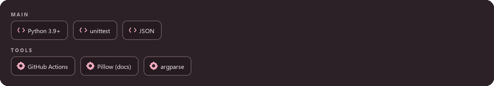
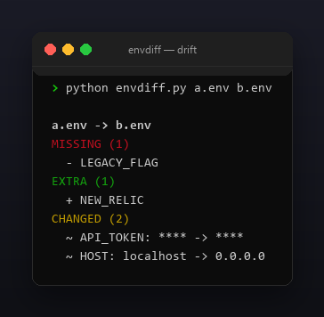
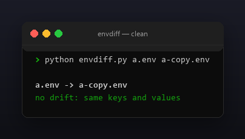

<p align="center"></p>

<p align="center">
  <a href="README.ru.md"></a>
  <a href="https://github.com/Celine1337/envdiff/releases"></a>
  <a href="https://github.com/Celine1337/envdiff/actions/workflows/ci.yml"></a>
  <a href="LICENSE"></a>
</p>


`.env` files drift: staging loses a key, production renames a token, and the
app fails at 3 a.m. with a missing setting. envdiff compares two `.env` files
semantically — order, comments and quoting style do not matter — and reports
exactly what drifted:

- MISSING — keys present in `A.env` but not in `B.env`;
- EXTRA — keys present in `B.env` but not in `A.env`;
- CHANGED — keys in both files with different values.

Single file, standard library only, Python 3.9+, no network.


- Parses `KEY=VALUE` lines: blank lines and `#` comments ignored, optional
  `export ` prefix, single/double quoted values, inline comments outside quotes.
- Secret-looking keys (name contains `SECRET`, `TOKEN`, `PASSWORD`, `PASSWD`,
  `KEY`, `API` or `CREDENTIAL`, case-insensitive) are masked as `****` in both
  text and JSON output; `--show-values` reveals them.
- `--ignore KEY[,KEY...]` (repeatable) to skip noisy keys.
- `--json` machine-readable report: `{missing, extra, changed:[{key,old,new}]}`.
- Exit codes for CI gating: `0` no drift, `1` drift found, `2` bad input/path.
- Colored ANSI group headers, `--no-color` and `NO_COLOR`.


| Group | Meaning |
|-------|---------|
| MISSING | key in `A.env`, absent from `B.env` |
| EXTRA | key in `B.env`, absent from `A.env` |
| CHANGED | key in both files, values differ |

| Input rule | Behavior |
|------------|----------|
| blank lines, `#` comments | ignored |
| `export KEY=VALUE` | `export ` prefix stripped |
| `KEY="a b"`, `KEY='a b'` | quotes removed, inner spaces kept |
| `KEY=val # note` | inline comment outside quotes stripped |
| duplicate `KEY` in one file | last occurrence wins |
| line without `KEY=`, unterminated quote | error, exit `2` |
| unreadable path / directory | error, exit `2` |





```console
$ python envdiff.py a.env b.env
$ python envdiff.py a.env b.env --ignore HOST,PORT
$ python envdiff.py a.env b.env --show-values
$ python envdiff.py a.env b.env --json
```

```
a.env -> b.env
MISSING (1)
  - LEGACY_FLAG
EXTRA (1)
  + NEW_RELIC
CHANGED (2)
  ~ API_TOKEN: **** -> ****
  ~ HOST: localhost -> 0.0.0.0
```

Exit codes: `0` — no drift, `1` — drift found, `2` — unreadable path or
malformed line.

Limits, on purpose: a line-based parser — no multi-line values, no `${VAR}`
expansion, no spaces around `=`; anything after a closing quote is treated as
a comment; secret detection is a substring heuristic (`MONKEY` matches `KEY`);
comparison is semantic, not a byte-level diff.







```console
$ python -m unittest discover -s tests -v
```

44 tests cover parsing, diff groups, secret masking, JSON shape and exit
codes. Fixtures are tiny temp files and every image is regenerable:

```console
$ pip install pillow
$ python tools/make_shots.py      # docs/drift.png, docs/clean.png
$ python tools/make_style.py tools/style.json docs/style
```


[MIT](LICENSE) © Celine1337