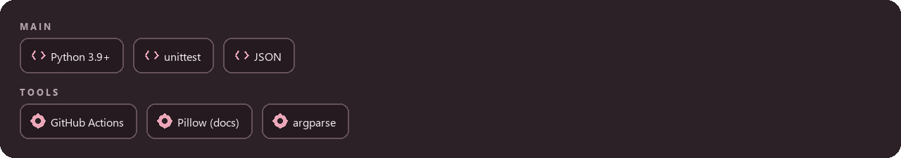
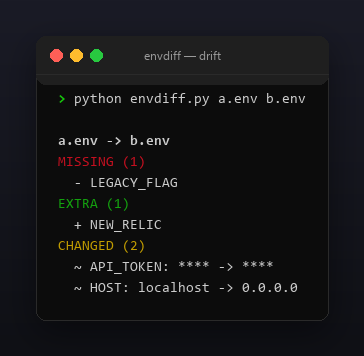
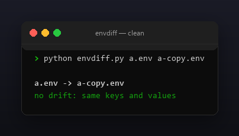

<p align="center"></p>

<p align="center">
  <a href="README.md"></a>
  <a href="https://github.com/Celine1337/envdiff/releases"></a>
  <a href="https://github.com/Celine1337/envdiff/actions/workflows/ci.yml"></a>
  <a href="LICENSE"></a>
</p>


`.env`-файлы расползаются: staging теряет ключ, production переименовывает
токен — и приложение падает в 3 ночи из-за отсутствующей настройки. envdiff
сравнивает два `.env`-файла семантически — порядок, комментарии и стиль
кавычек не важны — и показывает, что именно разъехалось:

- MISSING — ключи есть в `A.env`, но нет в `B.env`;
- EXTRA — ключи есть в `B.env`, но нет в `A.env`;
- CHANGED — ключи в обоих файлах, значения различаются.

Один файл, только стандартная библиотека, Python 3.9+, без сети.


- Парсит строки `KEY=VALUE`: пустые строки и `#`-комментарии игнорируются,
  необязательный префикс `export `, одинарные/двойные кавычки, inline-комментарии
  вне кавычек.
- Ключи, похожие на секреты (имя содержит `SECRET`, `TOKEN`, `PASSWORD`,
  `PASSWD`, `KEY`, `API` или `CREDENTIAL`, без учёта регистра), маскируются как
  `****` и в тексте, и в JSON; `--show-values` раскрывает значения.
- `--ignore KEY[,KEY...]` (можно повторять) — пропустить шумные ключи.
- `--json` — машинный отчёт: `{missing, extra, changed:[{key,old,new}]}`.
- Коды возврата для CI-гейта: `0` — дрейфа нет, `1` — дрейф найден,
  `2` — плохой ввод/путь.
- Цветные ANSI-заголовки групп, `--no-color` и `NO_COLOR`.


| Группа | Смысл |
|--------|-------|
| MISSING | ключ есть в `A.env`, отсутствует в `B.env` |
| EXTRA | ключ есть в `B.env`, отсутствует в `A.env` |
| CHANGED | ключ в обоих файлах, значения различаются |

| Правило ввода | Поведение |
|---------------|-----------|
| пустые строки, `#`-комментарии | игнорируются |
| `export KEY=VALUE` | префикс `export ` снимается |
| `KEY="a b"`, `KEY='a b'` | кавычки снимаются, пробелы внутри сохраняются |
| `KEY=val # note` | inline-комментарий вне кавычек отбрасывается |
| повтор `KEY` в одном файле | побеждает последнее значение |
| строка без `KEY=`, незакрытая кавычка | ошибка, код `2` |
| нечитаемый путь / каталог | ошибка, код `2` |





```console
$ python envdiff.py a.env b.env
$ python envdiff.py a.env b.env --ignore HOST,PORT
$ python envdiff.py a.env b.env --show-values
$ python envdiff.py a.env b.env --json
```

```
a.env -> b.env
MISSING (1)
  - LEGACY_FLAG
EXTRA (1)
  + NEW_RELIC
CHANGED (2)
  ~ API_TOKEN: **** -> ****
  ~ HOST: localhost -> 0.0.0.0
```

Коды возврата: `0` — дрейфа нет, `1` — дрейф найден, `2` — нечитаемый путь
или сломанная строка.

Ограничения сознательные: построчный парсер — без многострочных значений,
без раскрытия `${VAR}`, без пробелов вокруг `=`; всё после закрывающей
кавычки считается комментарием; поиск секретов — эвристика по подстроке
(`MONKEY` попадает под `KEY`); сравнение семантическое, не побайтовый diff.







```console
$ python -m unittest discover -s tests -v
```

44 теста покрывают парсинг, группы дрейфа, маскировку секретов, форму JSON и
коды возврата. Фикстуры — крошечные временные файлы, все картинки
перегенерируются:

```console
$ pip install pillow
$ python tools/make_shots.py      # docs/drift.png, docs/clean.png
$ python tools/make_style.py tools/style.json docs/style
```


[MIT](LICENSE) © Celine1337